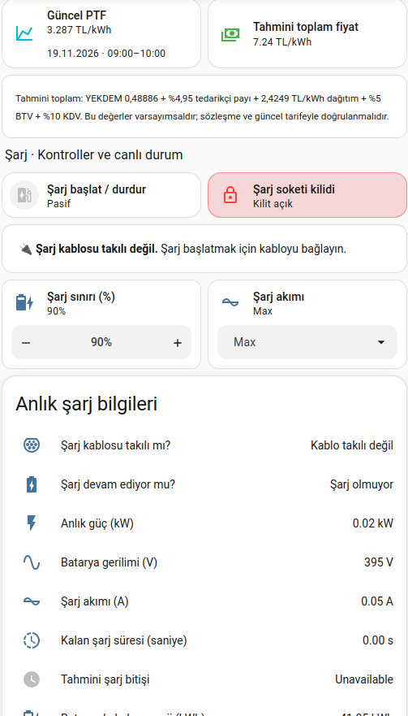

# MG4 Cockpit · HACS kurulum test sürümü

> **Deneysel sürüm:** Otomatik dashboard kaydı kodlandı ve yerel testlerden geçti; gerçek Home Assistant üzerinde henüz doğrulanmadı. Mevcut yapılandırmanızı yedekleyin.

MG4 Cockpit, SAIC iSmart MQTT Gateway ile Home Assistant'a aktarılan araç bilgilerini tek panelde birleştirir. Kokpit, şarj yönetimi, klima/konfor, araç durumu, konum, sürüş analizi ve sistem izleme ekranlarını içerir. Görseller gerçek Home Assistant ekran görüntüleridir; konum görseli gizlilik için bulanıklaştırılmıştır.

| Kokpit | Şarj | Analiz |
|---|---|---|
|  |  |  |

## Ön koşullar

- Home Assistant ve HACS kurulu olmalı.
- [SAIC Python MQTT Gateway](https://github.com/SAIC-iSmart-API/saic-python-mqtt-gateway) kurulmuş, MQTT Discovery ile araç varlıkları Home Assistant'ta görünür olmalı.
- Dashboard için şu HACS frontend kartları gerekli: `button-card`, `mushroom`, `apexcharts-card`, `config-template-card`, `ha-openfreemap-card`.
- Home Assistant yapılandırmasının tam yedeğini alın. **Aynı MG4 paketlerini zaten kullanan sisteme paralel kurmayın.**

## HACS ile kurulum (mevcut test sürümü)

1. HACS / Marketplace → Özel depolar → `https://github.com/nirnaeth-arnoediad/MG4-Home-Assistant-Cockpit` → **Integration** kategorisi → Ekle.
2. HACS'ten MG4 Cockpit'i indirin ve Home Assistant'ı yeniden başlatın.
3. Ayarlar → Cihazlar ve Hizmetler → Entegrasyon ekle → **MG4 Cockpit Kurulum**.
4. Gateway'in oluşturduğu VIN algılanırsa listeden aracı seçin; algılanmazsa VIN'i elle girin.
5. Entegrasyon, `/config/packages/mg4_cockpit_*.yaml` dosyalarını ve `/config/mg4_cockpit_dashboard.yaml` dosyasını oluşturur. **Var olan dosyaların üzerine yazmaz.**
6. `/config/configuration.yaml` içinde `homeassistant:` bölümünde `packages: !include_dir_named packages` yapılandırması yoksa mevcut ayarlarınızla birleştirerek ekleyin. Dosyanın başına ikinci bir `homeassistant:` anahtarı eklemeyin.
7. **Dashboard otomatik kaydedilir:** `/config/configuration.yaml` içinde henüz `lovelace:` bölümü yoksa kurulum bileşeni yalnızca yeni bir `MG4 Cockpit (HACS)` YAML panosu tanımlar. `configuration.yaml.mg4_cockpit_backup` adlı yerel yedek oluşturur. Var olan panoları değiştirmez. **Dashboardun sol menüde görünmesi için Home Assistant'ı yeniden başlatın.**
8. Dashboard için gereken özel kartları HACS üzerinden kurun ve 7 sekmenin açıldığını kontrol edin.

### Daha önce beta sürümünü kuranlar

- GitHub'da güncel dosyaları `main` dalına yükleyin, HACS'ten MG4 Cockpit'i güncelleyin ve Home Assistant'ı yeniden başlatın.
- Var olan entegrasyon kaydı açıldığında pano kaydı denenir; `/config/mg4_cockpit_dashboard.yaml` dosyası zaten varsa yeniden üretilmez veya üzerine yazılmaz.
- Pano kaydı eklendiyse **bir kez daha yeniden başlatın**. Eski MG4 dashboardunu silmeyin.

### Otomatik kaydın güvenlik sınırı

- `configuration.yaml` içinde **zaten `lovelace:` bölümü varsa** kurulum bu bölümü değiştirmez. Kullanıcıya özel kaynaklar, panolar veya `!include` kullanımı korunur. Bu durumda pano kaydı için mevcut Lovelace ayarlarıyla birleştirme gerekir.
- `configuration.yaml` yoksa veya dashboard dosyası eksikse hiçbir ayar yazılmaz.
- HACS, `button-card`, `mushroom`, `apexcharts-card`, `config-template-card`, `ha-openfreemap-card` bağımlılıklarını bu sürümde otomatik kurmaz.
- Mevcut `packages` ayarını otomatik değiştirmez. `/config/packages` klasörünün `homeassistant.packages` altında tanımlı olması gerekir.
- EPİAŞ isteğe bağlıdır ve otomatik kurulmaz.

## Güvenlik

- VIN yalnızca yerel üretilen YAML dosyalarında kullanılır. Bu dosyaları herkese açık GitHub deposuna yüklemeyin.
- Kurulum sırasında mevcut YAML dosyalarının üzerine yazılmaz. Kısmi yazma hatasında yeni oluşturulan dosyalar geri alınır.
- Entegrasyon kaldırılınca oluşturulmuş kullanıcı dosyaları otomatik silinmez.
- Araç algılama mevcut Home Assistant varlık kayıtlarını okur; araca yeni veri sorgusu göndermez.
- EPİAŞ isteğe bağlıdır; bu kurulum paketine otomatik dahil edilmez.

## Kaynak ve teşekkür

Araç iletişiminde [SAIC Python MQTT Gateway](https://github.com/SAIC-iSmart-API/saic-python-mqtt-gateway) kullanılır. Geliştirici **[nanomad](https://github.com/SAIC-iSmart-API/saic-python-mqtt-gateway/commits?author=nanomad)** ve katkıda bulunanlara teşekkürler. MG4 Cockpit'e özgü dashboard, YAML ve kurulum bileşeni proje sahibinin yönlendirmeleriyle ChatGPT yardımıyla hazırlanmıştır.
