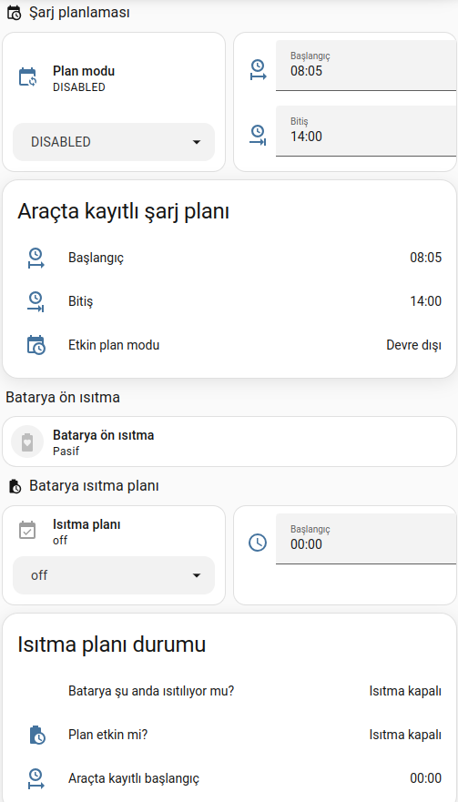
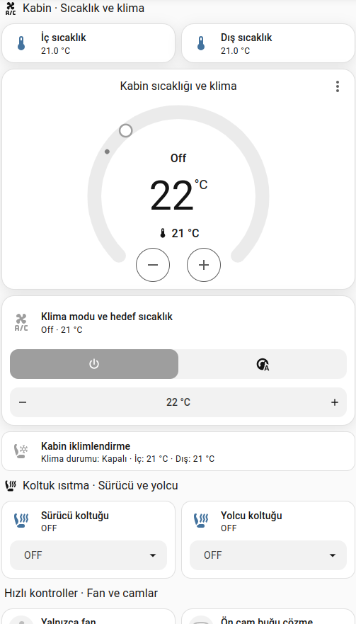
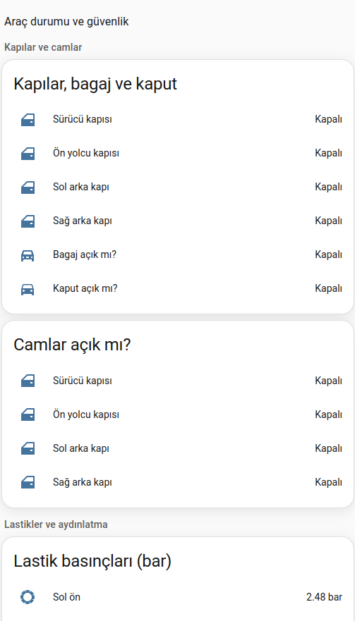
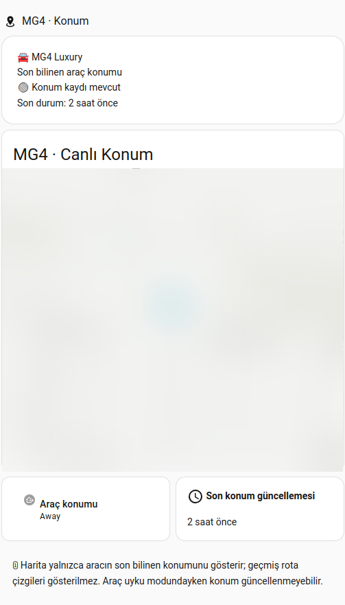
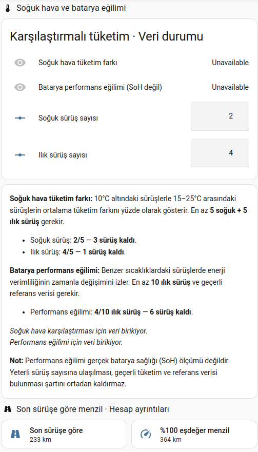
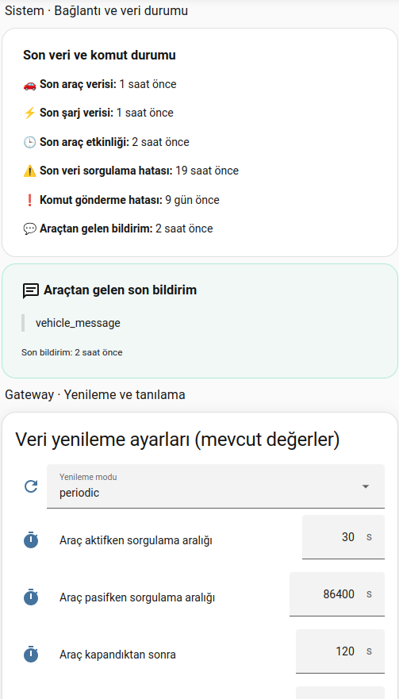

# MG4 Home Assistant Cockpit

MG4 elektrikli araç için Home Assistant üzerinde geliştirilmiş, Türkçe bir kontrol ve analiz panelidir. Batarya durumu, menzil, şarj yönetimi, konfor kontrolleri ve sürüş analizlerini tek arayüzde toplar.

> **Durum:** Deneysel YAML sürümü. Farklı Home Assistant kurulumlarında sensör adları ve özel kart bağımlılıkları değişebilir. HACS ile otomatik kurulum henüz yayımlanmamıştır. Kurulumdan önce yapılandırmanızı yedekleyin.

## Ekran görüntüleri ve proje tanıtımı

MG4 Cockpit, araç bilgilerini Home Assistant üzerinde yedi sekmede bir araya getirir. Aşağıdaki görseller, çalışan sistemden alınmış **gerçek mobil ekran görüntüleridir**. Görüntülerdeki değerler örnektir; veri kullanılabilirliği gateway'e, araç durumuna ve Home Assistant yapılandırmasına bağlıdır.

### Kokpit · Tek ekranda araç özeti

Batarya doluluk oranı, tahmini menzil, araç durumu, kilitler, sıcaklık ve temel araç bilgileri.

### Enerji · Şarj kontrolü ve izleme

Şarj başlatma/durdurma, soket kilidi, şarj sınırı, akım seçimi ve canlı şarj ölçümleri. EPİAŞ PTF ve tahmini fiyat kartları **isteğe bağlı modüldür**; gösterilen maliyet hesabı varsayımsaldır.

### Planlar · Şarj ve batarya ön ısıtma

Araçtaki şarj zamanlaması, plan modu ve batarya ön ısıtma durumu.

### Konfor · Klima ve koltuk ısıtma

Kabin sıcaklığı, iklimlendirme ayarları ve koltuk ısıtma kontrolleri.

### Araç · Güvenlik ve durum

Kapı, bagaj, kaput, cam ve lastik durumlarını tek sayfadan izleme.

### Konum · Son bilinen araç konumu

Araçtan alınan son konum ve güncelleme zamanı. Harita **canlı takip veya geçmiş rota** anlamına gelmez. Gizlilik amacıyla ekran görüntüsündeki harita bulanıklaştırılmıştır.

### Analiz · Menzil tahmini doğruluğu

Gösterge menzili ile gerçekleşen sürüş arasındaki sapma ve zaman içindeki doğruluk eğilimi.

### Analiz · Soğuk hava ve batarya eğilimi

Soğuk ve ılık hava sürüşlerinin tüketim karşılaştırması ve yeterli veri toplandığında batarya performans eğilimi. **Bu gösterge gerçek batarya sağlığı (SoH) ölçümü değildir.**

### Sistem · Gateway ve veri durumu

Son araç verileri, komut bildirimleri ve gateway yenileme ayarları; veri gecikmelerini ve bağlantı durumunu değerlendirmek için.

---

## Araç ile iletişim

Bu proje MG iSMART hesabından araç verilerini alabilmek ve Home Assistant'a MQTT üzerinden aktarabilmek için **[SAIC Python MQTT Gateway](https://github.com/SAIC-iSmart-API/saic-python-mqtt-gateway)** projesini kullanır.

Gateway; araç verilerini MQTT üzerinden yayımlar ve Home Assistant MQTT Discovery ile sensör ve kontrol varlıklarının oluşmasını sağlar. Bu depo gateway'in yerine geçmez; onun sağladığı veriler üzerinde dashboard, yardımcı sensör ve otomasyonlar oluşturur.

**Teşekkür:** SAIC Python MQTT Gateway projesinin geliştiricisi **nanomad** başta olmak üzere tüm katkıda bulunanlara teşekkür ederiz. Bu proje, onların sağladığı iletişim altyapısı sayesinde geliştirilmiştir.

## Kodların hazırlanması

Bu depodaki dashboard, YAML yardımcıları, analizler ve EPİAŞ entegrasyonunun proje özelindeki kodları, proje sahibinin gereksinimleri doğrultusunda **OpenAI ChatGPT (GPT-6) desteğiyle hazırlanmış ve düzenlenmiştir**. Testler ve işlevsel doğrulamalar proje sahibi tarafından kendi Home Assistant ortamında yürütülmüştür. SAIC Python MQTT Gateway ayrı bir açık kaynak projesidir; onun kodlarının yazarlığı bu depoya ait değildir.

## Özellikler

- MG4 batarya seviyesi, menzil ve araç durumu
- Şarj planlaması ve şarj oturumu takibi
- İklimlendirme ve batarya ön ısıtma kontrolleri
- Sürüş ve tüketim analizleri
- Türkçe durum göstergeleri
- **İsteğe bağlı:** EPİAŞ saatlik PTF takibi ve tahmini enerji maliyeti

## Kurulum

1. Home Assistant sisteminizin yedeğini alın.
2. [SAIC Python MQTT Gateway](https://github.com/SAIC-iSmart-API/saic-python-mqtt-gateway) kurulumunu tamamlayın. MQTT sensörlerinin Home Assistant'ta oluştuğunu doğrulayın.
3. Dashboardun kullandığı özel kartların sisteminizde bulunduğundan emin olun. Sensör adları gateway sürümüne göre farklılık gösterebilir.
4. Bilgisayarınızda `python3 tools/configure_vin.py --vin KENDI_17_HANELI_VIN --output local` komutunu çalıştırın. Oluşan `local/` klasörünü **GitHub'a yüklemeyin**.
5. `local/packages/*.yaml` dosyalarını `/config/packages/` klasörüne kopyalamadan önce mevcut yardımcılar ve otomasyonlarla çakışmaları inceleyin. `homeassistant: packages: !include_dir_named packages` tanımını mevcut yapılandırmanızla birleştirin.
6. `local/dashboards/mg4_cockpit.yaml` dosyasını YAML modundaki bir dashboarda aktarın. Gerektiğinde sensör adlarını uyarlayın.
7. Home Assistant yapılandırmasını doğrulayın. Araç kontrol komutlarını dikkatli ve gözetim altında test edin.

## EPİAŞ modülü (isteğe bağlı)

EPİAŞ modülü Türkiye'deki kullanıcılar içindir ve ana dashboardun çalışması için zorunlu değildir. Betik, sensör, saatlik otomasyon ve ek fiyat kartları `epias/` klasöründe bulunur. Kurulum adımları: [EPİAŞ rehberi](epias/README.md).

## Klasörler

| Klasör | İçerik |
|---|---|
| `dashboards/` | MG4 kontrol paneli |
| `packages/` | Yardımcı sensörler, sürüş analizleri ve otomasyonlar |
| `epias/` | İsteğe bağlı elektrik fiyatı entegrasyonu |
| `tools/` | VIN'i yalnızca yerel kopyalara uygulama aracı |
| `examples/` | Örnek Home Assistant yapılandırmaları |
| `docs/` | Yayımlama öncesi kontrol listesi ve gerçek ekran görüntüleri |

## Gizlilik ve güvenlik

Gerçek VIN, iSMART ve EPİAŞ giriş bilgileri, `secrets.yaml`, erişim anahtarları, konum geçmişi ve kişisel otomasyonlar GitHub'a yüklenmemelidir. Bu depodaki `YOUR_VIN` yer tutucusu gerçek VIN ile yalnızca yerel ortamda değiştirilmelidir.

## Lisans

Proje özelinde oluşturulan kodlar MIT lisansı ile sunulmuştur. Kullanılan üçüncü taraf yazılımlar ve özel Home Assistant kartları kendi lisanslarına tabidir. MG, SAIC veya EPİAŞ ile resmî bağlantısı yoktur.
