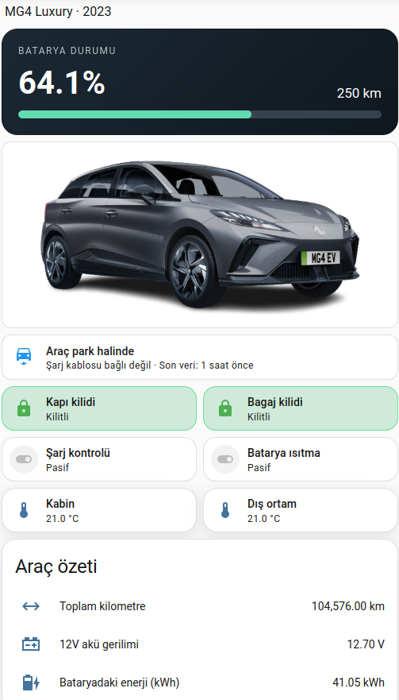
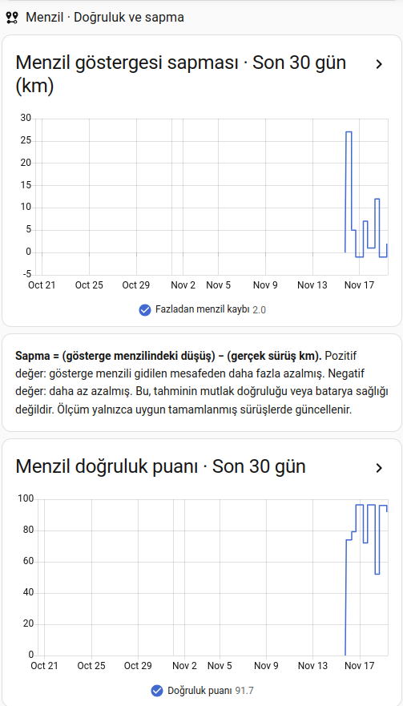

# MG4 Cockpit · HACS kurulum test sürümü

> **Deneysel sürüm:** Otomatik dashboard kaydı kodlandı ve yerel testlerden geçti; gerçek Home Assistant üzerinde henüz doğrulanmadı. Mevcut yapılandırmanızı yedekleyin.

MG4 Cockpit, SAIC iSmart MQTT Gateway ile Home Assistant'a aktarılan araç bilgilerini tek panelde birleştirir. Kokpit, şarj yönetimi, klima/konfor, araç durumu, konum, sürüş analizi ve sistem izleme ekranlarını içerir. Görseller gerçek Home Assistant ekran görüntüleridir; konum görseli gizlilik için bulanıklaştırılmıştır.

| Kokpit | Şarj | Analiz |
|---|---|---|
|  |  |  |

## Ön koşullar

- Home Assistant ve HACS kurulu olmalı.
- [SAIC Python MQTT Gateway](https://github.com/SAIC-iSmart-API/saic-python-mqtt-gateway) kurulmuş, MQTT Discovery ile araç varlıkları Home Assistant'ta görünür olmalı.
- Dashboard için şu HACS frontend kartları gerekli: `button-card`, `mushroom`, `apexcharts-card`, `config-template-card`, `ha-openfreemap-card`.
- Home Assistant yapılandırmasının tam yedeğini alın. **Aynı MG4 paketlerini zaten kullanan sisteme paralel kurmayın.**

## HACS ile kurulum (v0.5 beta)

1. HACS / Marketplace üzerinden depoyu **Integration** olarak ekle ve MG4 Cockpit'i indir.
2. Home Assistant'ı yeniden başlat. Ayarlar → Cihazlar ve Hizmetler → Entegrasyon ekle → MG4 Cockpit Kurulum.
3. Aracını seç. Entegrasyon, MG4 dosyalarını hazırlar ve **MG4 Cockpit (HACS)** panosunu sol menüye eklemeyi dener.
4. Gerekli özel kartların (`button-card`, `mushroom`, `apexcharts-card`, `config-template-card`, `ha-openfreemap-card`) yüklü olduğunu kontrol et.

`configuration.yaml` dosyasına pano kaydı eklenmez. MG4 paketlerinin çalışması için Home Assistant'ta `homeassistant.packages` ayarı **önceden etkin** olmalıdır; bu sürüm o ayarı da değiştirmez. İlk kurulumda üretilen YAML paketleri için yeniden başlatma gerekebilir. EPİAŞ isteğe bağlıdır.

## Güvenlik

- VIN yalnızca yerel üretilen YAML dosyalarında kullanılır. Bu dosyaları herkese açık GitHub deposuna yüklemeyin.
- Kurulum sırasında mevcut YAML dosyalarının üzerine yazılmaz. Kısmi yazma hatasında yeni oluşturulan dosyalar geri alınır.
- Entegrasyon kaldırılınca oluşturulmuş kullanıcı dosyaları otomatik silinmez.
- Araç algılama mevcut Home Assistant varlık kayıtlarını okur; araca yeni veri sorgusu göndermez.
- EPİAŞ isteğe bağlıdır; bu kurulum paketine otomatik dahil edilmez.

## Kaynak ve teşekkür

Araç iletişiminde [SAIC Python MQTT Gateway](https://github.com/SAIC-iSmart-API/saic-python-mqtt-gateway) kullanılır. Geliştirici **[nanomad](https://github.com/SAIC-iSmart-API/saic-python-mqtt-gateway/commits?author=nanomad)** ve katkıda bulunanlara teşekkürler. MG4 Cockpit'e özgü dashboard, YAML ve kurulum bileşeni proje sahibinin yönlendirmeleriyle ChatGPT yardımıyla hazırlanmıştır.
